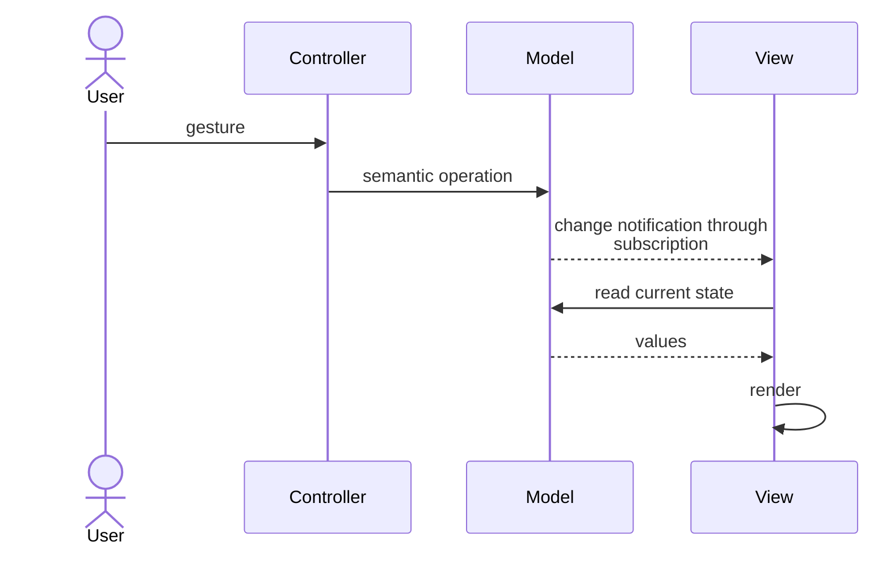

> **[Model-View-Controller](README.md)** › The Flow.

# The Flow

An order screen shows **Pending**. The user clicks **Cancel**. The [Controller](../../../../GLOSSARY.md#controller) interprets the click as a cancellation request, the [Model](../../../../GLOSSARY.md#model) reflects the result, and the [View](../../../../GLOSSARY.md#view) can refresh when it learns the represented information changed. That is the kind of interaction described by classic [MVC](../../../../GLOSSARY.md#model-view-controller-mvc).

The diagram below shows **events and calls over time**, not which source files import which others. A change notification means “the represented information changed; refresh what you show,” not “the Model must import a concrete UI component.”

**Contents**

- [The classic cycle](#the-classic-cycle)
- [Why the Observer link is the hard part](#why-the-observer-link-is-the-hard-part)
- [The variants change more than one connection](#the-variants-change-more-than-one-connection)
- [Server-rendered web MVC](#server-rendered-web-mvc)
- [Sources](#sources)

## The classic cycle

This sequence describes a screen that remains open and observes its Model, as explained in [Fowler's account of Smalltalk MVC](https://martinfowler.com/eaaDev/uiArchs.html#ModelViewController). It is not a general request lifecycle for every framework named MVC.

The [View](../../../../GLOSSARY.md#view) knows how to read the [Model](../../../../GLOSSARY.md#model); the [Controller](../../../../GLOSSARY.md#controller) interprets the gesture. The Model invokes registered listeners through an abstract notification mechanism, without naming concrete screens. It can have several observers. This is not an acyclic runtime pipeline: rendering reads back from the Model.

## Why the Observer link is the hard part

Observation introduces lifetime and synchronization work: subscribe, perform an initial render, release the subscription, and avoid stale or redundant updates. A framework can perform some of that work, but architectural separation still requires an explicit owner for policy and screen behavior.

## The variants change more than one connection

Fowler distinguishes several presentation approaches. They share separation goals but move responsibilities, rather than merely renaming identical objects.

| Approach | [View](../../../../GLOSSARY.md#view) relationship | Input and synchronization |
| --- | --- | --- |
| Classic [MVC](../../../../GLOSSARY.md#model-view-controller-mvc) | observes and reads [Model](../../../../GLOSSARY.md#model) | [Controller](../../../../GLOSSARY.md#controller) interprets input; Model notifies |
| [Passive View](../../../../GLOSSARY.md#passive-view) | no Model access; driven through a view interface | [Presenter](../../../../GLOSSARY.md#presenter)/Controller updates controls and interprets events |
| [Supervising Controller](../../../../GLOSSARY.md#supervising-controller) | simple display binding can read Model | Controller handles input and complex presentation updates |
| [Presentation Model](../../../../GLOSSARY.md#presentation-model) | reads a screen-oriented state/behavior object | screen state is synchronized explicitly or through binding |
| [MVVM](../../../../GLOSSARY.md#model-view-viewmodel-mvvm) | binds to a [ViewModel](../../../../GLOSSARY.md#viewmodel)'s values/commands | binding plus commands; one-way or two-way depending on platform |

[MVP](../../../../GLOSSARY.md#model-view-presenter-mvp) is an umbrella with historical variants, including passive and supervising arrangements. Passive View does not describe every MVP implementation. MVVM does not require every value to have a two-way binding. Reactive rendering alone proves none of these role assignments.

## Server-rendered web MVC

A cancellation form submits an HTTP request. In a server-rendered MVC arrangement:

1. Routing selects a Controller action for the request.
2. The Controller invokes the operation that attempts cancellation and obtains its outcome.
3. The Controller selects a View and supplies the information to display.
4. The View renders HTML, which the server sends to the browser.

This is one illustrative rendering path; a Controller can instead redirect or return another response. [ASP.NET Core describes Controller selection of Views](https://learn.microsoft.com/en-us/aspnet/core/mvc/overview?view=aspnetcore-10.0#mvc-pattern); [Rails describes the request cycle and rendering](https://guides.rubyonrails.org/action_controller_overview.html#introduction).

The template normally finishes its work for that response. It does not remain subscribed to the server Model as an open Smalltalk View would. A later browser update requires another interaction or an explicitly added update mechanism.

A JSON API can omit HTML rendering altogether. For example, [Nest serializes returned objects to JSON](https://docs.nestjs.com/controllers#routing). Having an HTTP Controller alone does not establish classic MVC. The [client/server comparison](README.md#mvc-across-client-and-server) distinguishes this delivery boundary from an interactive frontend's own presentation design.

Next: **[MVC on the Frontend](3-mvc-on-the-frontend.md)** — intentional responsibility boundaries inside modern component frameworks.

## Sources

- [Reenskaug — Models, Views, Controllers (1979)](https://doi.org/10.5281/zenodo.3676092)
- [Fowler — GUI Architectures](https://martinfowler.com/eaaDev/uiArchs.html)
- [Fowler — Passive View](https://martinfowler.com/eaaDev/PassiveScreen.html)
- [Fowler — Supervising Controller](https://martinfowler.com/eaaDev/SupervisingPresenter.html)
- [Fowler — Presentation Model](https://martinfowler.com/eaaDev/PresentationModel.html)
- [ASP.NET Core — MVC pattern](https://learn.microsoft.com/en-us/aspnet/core/mvc/overview?view=aspnetcore-10.0#mvc-pattern)
- [Rails — Action Controller Overview](https://guides.rubyonrails.org/action_controller_overview.html#introduction)
- [Nest — Controllers](https://docs.nestjs.com/controllers#routing)
