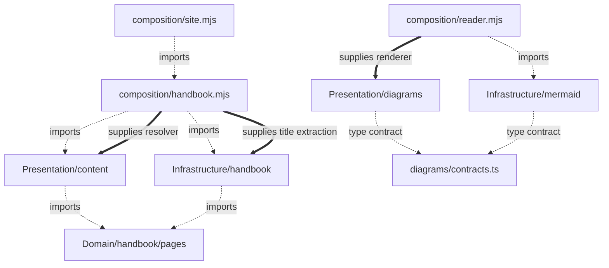
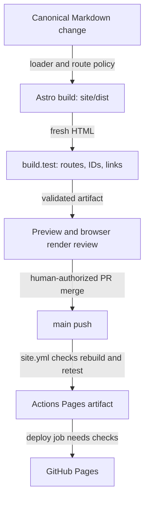

# Static handbook delivery

Canonical Markdown stays at the repository root. Astro 7.4.0 and Starlight 0.42.6 read it directly; generated content is not editable source. The reader applies the handbook's frontend ownership rules with native Astro components and browser APIs. A static deployment does not exempt its UI from those rules.

## Contents

- [Ownership and dependencies](#ownership-and-dependencies)
- [Styling](#styling)
- [Guide-to-code evidence](#guide-to-code-evidence)
- [Three change scenarios](#three-change-scenarios)
- [Canonical content and delivery](#canonical-content-and-delivery)
- [Sources](#sources)

## Ownership and dependencies

`src/domain/handbook/pages.mjs` owns which canonical documents are reader pages, stable route spelling and collision rejection. It imports neither filesystem nor Astro. `src/infrastructure/handbook/astroHandbook.mjs` discovers files, resolves directory READMEs, enforces real-path containment (including symlinks) and adapts the Content Layer loader. `src/presentation/content/index.mjs` owns parsed titles, heading IDs, legacy aliases and link representations. It receives file identity and target resolution rather than importing filesystem code. Both reuse the canonical route policy. `src/composition/handbook.mjs` supplies those collaborators and gives title extraction to the loader. `src/content.config.ts` and `astro.config.mjs` are framework entries delegating to composition. The compatibility `src/handbook.mjs` entry preserves existing tooling imports, not another implementation.

Dashed arrows are source dependencies; thick arrows are composition supplying collaborators. At runtime the Markdown transformer calls its supplied resolver, and the loader calls supplied title extraction. Neither consumer imports the other's concrete implementation. Placement follows meaning, even with a single consumer; reuse is not a prerequisite for separating presentation from filesystem effects.

Inside Presentation, diagrams, theme and reader are separate capabilities. `presentation/diagrams/index.mjs` exposes only `mountDiagrams`; its renderer dependency promises `render(source, id, resolvedTheme): Promise<string>` containing sanitized SVG. Composition supplies `infrastructure/mermaid/createMermaidRenderer.mjs`. That adapter owns Mermaid loading, strict security and serialization of its global initialization/render calls. A failed render does not poison later calls. The UI does not import Mermaid or discover its dependencies through a service locator.

`presentation/diagrams/state/diagram.state.mjs` calculates immutable zoom/pan transitions without DOM or storage. `components/DiagramDialog.mjs` owns native modal effects, keyboard/buttons and SVG restoration. `mountDiagrams.mjs` owns preview status/failure feedback, discards stale asynchronous results, and exposes cleanup. A theme change closes an expanded dialog before replacing its SVG, restoring focus through the existing close handler. Diagram source remains usable without JavaScript or when rendering fails.

`composition/ReaderFooter.astro` connects the native footer wrapper to browser startup. Presentation does not import composition. Header composes Starlight's native title, search, social links and ThemeSelect. The theme control stays in the header at mobile and desktop widths, without covering article content. Navigation also retains the native synchronized picker; there is one theme implementation.

`presentation/theme/index.mjs` exposes resolved-theme observation only. Starlight owns the `starlight-theme` storage key, initial selection, persistence, picker synchronization and system preference updates. Its native `auto` option means System; `src/content/i18n/en.json` supplies that visible label through Starlight’s supported translation collection. No custom storage key, theme store, reducer or second system-preference listener exists. Theme and zoom are visual policies in Presentation, not Domain/Application. There is no application workflow to justify an empty Application layer, React, Redux or a DI container.

## Styling

`presentation/design-system/tokens.css` owns raw blue/paper/gold primitives, their semantic Starlight palette mappings and reader surface/border/backdrop aliases. `global.css` owns focus and reduced-motion policy. Capability CSS consumes semantic tokens: `diagrams/diagrams.css` owns preview/dialog slots; `reader/reader.css` owns article overflow behavior. Small Astro wrappers keep their styles with their components. `src/styles/reader.css` only imports those owners. Starlight remains the styling foundation; adding Panda is not necessary to apply the guide's ownership pipeline.

## Guide-to-code evidence

All paths in the first column are relative to `architecture/frontend/`; implementation paths are relative to `site/src/`.

| Guide reviewed | Concrete owner or decision | Evidence |
| --- | --- | --- |
| `README.md` | Layer-first `domain/`, `infrastructure/`, `presentation/`, `composition/`; visual capabilities inside Presentation | `tests/architecture.test.mjs` checks inward imports and cross-capability entries |
| `presentation-architecture.md` | `reader/components/ReaderHeader.astro` composes native controls; `diagrams/index.mjs` is narrow | AST boundary test; Astro check/build |
| `ports-and-adapters.md` | `composition/reader.mjs` supplies `createMermaidRenderer` to `mountDiagrams` | Injected renderer failure/stale-result test; adapter serialization test |
| `state-management.md` | `diagrams/state/diagram.state.mjs` is pure; DOM changes stay in dialog/mount | Frozen-input transitions; DOM/storage dependency prohibition |
| `styling-and-design-system.md` | `design-system/{tokens,global}.css`, colocated capability styles | Build processes imports; visual contrast/readability remains browser acceptance |
| `reference-case-study.md` | No application-wide UI contract, competing theme store or duplicated diagram recipe; explicit composition | Source-boundary checks include reexports and literal dynamic imports |
| `references.md` | Use native framework behavior, not React/Redux mechanisms copied as architecture | Installed Starlight ThemeProvider/ThemeSelect exercised in `tests/theme.test.mjs` |
| `exercises/README.md` | Responsibility and observable behavior guide the refactor | Independent tests retain canonical output rather than copying source content |
| `exercises/easy.md` | UI state versus content policy versus Mermaid integration | Pure transitions, route/collision tests, renderer test |
| `exercises/intermediate.md` | Replace reader integration without modifying UI; components receive collaborators | Fake renderer runs the actual diagram mount; rule remains in `domain/handbook/pages.mjs` |
| `exercises/advanced.md` | No cross-capability private state import; effects outside reducer | AST public-entry checks and state I/O prohibition |
| `exercises/solutions.md` | Explicit assembly, preserved internal facts and safe integration failure feedback | Stale render/failure disclosure test; 76 canonical Mermaid parser regressions |

The boundary test uses the installed Astro compiler's structured AST for frontmatter and scripts (including literal script sources), and TypeScript's AST for JS/TS. Negative fixtures exercise imports, reexports, dynamic imports and private capability access with Windows and POSIX paths; nonliteral dynamic imports fail closed. This is not a general module resolver: aliases, CommonJS require and arbitrary computed runtime loading are outside its current scope. `npm run check` also runs a directed TypeScript contract project: the Mermaid implementation and pure transitions use checked JSDoc, and compile-negative fixtures ensure the renderer return type, consumer options and numeric view state stay enforced. No mass JS conversion is required.

## Three change scenarios

1. Change a content rule: edit `domain/handbook/pages.mjs` and its route/selection tests. The filesystem loader reuses that policy; diagram state and theme controls do not change. Change the zoom limit instead: edit only diagram Presentation state and its tests, not Domain.
2. Replace an integration: supply another implementation of the renderer conversation in `composition/reader.mjs`. `mountDiagrams` and dialog state remain unchanged. The adapter test checks serialized setup/failure recovery, while the fake renderer test checks consumer behavior. Filesystem/loader replacement remains separate from content-selection policy.
3. Add a reader capability: create `presentation/<capability>/` with a narrow entry and local styles, wire it in composition and add boundary/behavior checks. Promote visual components only when unrelated consumers demonstrate a shared contract. Do not add another theme owner or a capability-local full layer stack.

## Canonical content and delivery

A canonical edit is not deployed by editing generated HTML. The same route policy and transformations run in PR validation and again after the authorized merge to `main`:

Solid arrows show delivery order, not source imports. PR checks never upload the production Pages artifact. Only a `main` push that passes the workflow's check/build/test/smoke steps uploads `site/dist`; deployment consumes that artifact with scoped Pages permissions. The browser review and merge authorization are human acceptance steps, not checks this local run can claim. A rejected route collision or unresolved link stops validation before publication.

The loader derives the title from the first parsed H1, preserves its anchor, allocates repeated-heading IDs before removing the visible source H1 and retains distinct legacy aliases. Relative Markdown targets must exist and stay inside the repository. README routes map to their directory; glossary maps to `/glossary/`; non-reader targets open GitHub main. The complete snapshot validates before store replacement; watcher updates are serialized. Canonical sources, anchors and diagram text were not edited.

Run from `site/`: `npm ci --ignore-scripts`, `npm run check`, `npm run build`, `npm test`, `npm run smoke`. Build tests inspect a fresh artifact. The current checks retain 92 reader pages plus 404, 5,156 local links/fragments and 76 Mermaid sources. The HTTP smoke covers six representative pages and ten assets. Native theme tests execute the installed provider/select scripts with DOM simulation: saved dark selection, explicit light override, System preference changes and synchronized pickers. They do not establish browser layout, native focus trapping or visual contrast.

Author-side Chromium on the VPS lacked `libatk-1.0.so.0`. Codex performed independent Windows Edge checks instead, corrected the mobile picker that obscured article text and the modal's per-figure ownership, and verified the resulting source candidate. [Verification evidence and limits](VERIFICATION.md) distinguish the full rendering/geometry matrix from sampled visual inspection, keyboard/theme checks and directed type checking. No unrelated system dependency was installed.

Native Starlight storage-denial behavior remains inherited, not replaced with a competing provider. The System label uses the native translation collection. The new boundary diagrams have parser verification only; final browser layout/light-dark/narrow inspection remains independent acceptance work.

The build still warns about large Mermaid chunks and the native 404 fallback. This increment ran check/build/tests/smoke on Node 22.22.1 with temporary npm 10.8.2 (`npm exec --yes --package=npm@10.8.2 -- npm ...`), without changing global configuration or dependencies. Ten moderate dependency audit findings were reported in the previous increment; the audit was not rerun here. See [deployment and recovery](DEPLOYMENT.md). No merge, Pages settings or production deployment is performed here.

## Sources

- [Astro Content Loader API](https://docs.astro.build/en/reference/content-loader-reference/)
- [Astro Markdown configuration](https://docs.astro.build/en/reference/configuration-reference/#markdownprocessor)
- [Starlight component overrides](https://starlight.astro.build/guides/overriding-components/)
- [Starlight CSS variables](https://starlight.astro.build/guides/css-and-tailwind/#starlight-css-variables)
- Native ThemeProvider, ThemeSelect and Header behavior checked against installed Starlight 0.42.6 source and actual build/tests.
